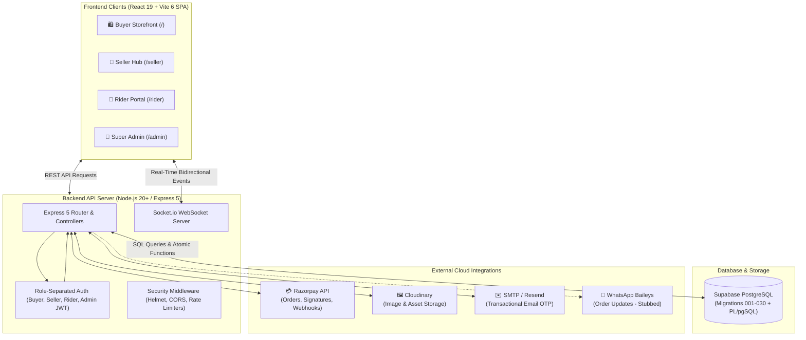

<p align="center">
  
</p>

<h3 align="center">Luxury Gifting Marketplace & Multi-Vendor E-Commerce Platform</h3>

<p align="center">
  A full-stack, production-grade e-commerce ecosystem built solo, featuring four distinct role-based portals, custom hamper builder, real-time WebSocket order tracking, doorstep OTP delivery verification, and hardened multi-tenant security.
</p>

<p align="center">
  <a href="https://react.dev/"></a>
  <a href="https://www.typescriptlang.org/"></a>
  <a href="https://vite.dev/"></a>
  <a href="https://tailwindcss.com/"></a>
  <a href="https://nodejs.org/"></a>
  <a href="https://expressjs.com/"></a>
  <a href="https://supabase.com/"></a>
  <a href="https://socket.io/"></a>
  <a href="https://razorpay.com/"></a>
</p>

<p align="center">
  <strong>Live Demo:</strong> <a href="https://www.nyochavar.in">nyochavar.in</a> &nbsp;•&nbsp;
  <strong>License:</strong> View Only (All Rights Reserved) &nbsp;•&nbsp;
  <strong>Repository:</strong> <a href="https://github.com/rmsachinmeena/Nyochavar-Public">Nyochavar-Public</a>
</p>

---

> [!NOTE]
> **Portfolio Copy:** This repository is a sanitized showcase of a private production project. All commercial credentials, API keys, and customer data have been removed. Certain proprietary background services—notably the WhatsApp (Baileys) bot automation engine and the seller payout ledger—have been stubbed for portfolio demonstration (see [Known Limitations](#known-limitations-and-roadmap)).

---

## 📑 Table of Contents

- [Overview & Portals](#-the-four-portals)
- [System Architecture](#-system-architecture)
- [UI & Visual Preview](#-ui--visual-preview)
- [Tech Stack](#-tech-stack)
- [Security & Engineering Highlights](#-security--engineering-highlights)
- [Database Schema & Migrations](#-database-schema--migrations)
- [Local Development Setup](#-local-development-setup)
- [Environment Variables](#-environment-variables)
- [Project Directory Structure](#-project-structure)
- [Key Learnings & Reflections](#-what-i-built-and-learned)
- [Known Limitations & Roadmap](#-known-limitations-and-roadmap)
- [License](#-license)

---

## 🏛️ The Four Portals

Nyochavar operates four independent role-based user interfaces powered by a unified Express API and Supabase PostgreSQL backend:

| Portal                  | Route Path | Target Audience              | Key Capabilities                                                                                                                                                                                                                                                                                 |
| :---------------------- | :--------: | :--------------------------- | :----------------------------------------------------------------------------------------------------------------------------------------------------------------------------------------------------------------------------------------------------------------------------------------------- |
| **🛍️ Buyer Storefront** |    `/`     | Customers & Shoppers         | • Interactive luxury gifting catalog<br>• Custom Hamper Builder with real-time pricing<br>• Razorpay payment gateway & COD support<br>• Live order tracking via Socket.io<br>• Profile dashboard with doorstep delivery OTP<br>• Google Sign-In, Phone OTP, & Email OTP auth                     |
| **🏪 Seller Hub**       | `/seller`  | Multi-vendor Merchants       | • Dedicated seller landing page & 4-step registration wizard<br>• Isolated vendor dashboard with store metrics<br>• Multi-step product listing wizard with variant images<br>• Vendor order fulfillment & status transitions<br>• Strict multi-tenant isolation (sellers only access their data) |
| **🛵 Rider Portal**     |  `/rider`  | Delivery Fleet Partners      | • Mobile-optimized PWA layout<br>• Rapid phone number & PIN-based authentication<br>• Live assigned dispatches & route addresses<br>• Secure doorstep handoff: delivery requires buyer OTP verification                                                                                          |
| **👑 Super Admin**      |  `/admin`  | Operations & Platform Admins | • Central business command center<br>• Banner, category, & product catalog governance<br>• Atomic coupon configuration & usage limits<br>• Rider fleet dispatch & live order monitoring<br>• Comprehensive audit logging & notification templates                                                |

---

## 📐 System Architecture

### Component & Data Flow



### Server & Realtime Topology

```
  React 19 + Vite (SPA)  ──REST API──▶  Express 5 API  ──SQL──▶  Supabase PostgreSQL
          │                                   │
          └───── Socket.io WebSockets ◀───────┤
                                              ├──▶ Razorpay (orders, verify, webhook)
                                              ├──▶ Cloudinary (image CDN)
                                              └──▶ SMTP / Resend (email OTP delivery)
```

The Express API and Socket.io share a single unified HTTP server instance. The client dynamically establishes API connections based on the `VITE_API_URL` environment configuration.

---

## 🎨 UI & Visual Preview

<p align="center">
  
</p>

### Portal Screenshot Gallery

Portal captures are cataloged in [`Docs/screenshots/`](Docs/screenshots):

|           Storefront Home           |       Custom Hamper Builder        |        Checkout Flow         |
| :---------------------------------: | :--------------------------------: | :--------------------------: |
| <sub>`01-storefront-home.png`</sub> | <sub>`02-hamper-builder.png`</sub> | <sub>`03-checkout.png`</sub> |

|           Seller Dashboard           |    Rider OTP Verification     |         Super Admin Console         |
| :----------------------------------: | :---------------------------: | :---------------------------------: |
| <sub>`04-seller-dashboard.png`</sub> | <sub>`05-rider-otp.png`</sub> | <sub>`06-admin-dashboard.png`</sub> |

> [!TIP]
> Refer to [Docs/screenshots/README.md](Docs/screenshots/README.md) for screenshot capture guidelines and resolution recommendations.

---

## 💻 Tech Stack

| Domain                 | Technology / Library                         | Description                                                                |
| :--------------------- | :------------------------------------------- | :------------------------------------------------------------------------- |
| **Frontend Framework** | **React 19**, **TypeScript**                 | Latest React features, strong typing across state, props, and API payloads |
| **Build & Styling**    | **Vite 6**, **Tailwind CSS 4**               | Blazing-fast HMR, modern CSS nesting, custom theme tokens                  |
| **Routing & Motion**   | **React Router 7**, **Framer Motion**        | Declarative route hierarchy, animated transitions, micro-interactions      |
| **Icons & UI Kit**     | **Lucide React**                             | Clean, lightweight feather-style UI iconography                            |
| **Backend Runtime**    | **Node.js 20+**, **Express 5**               | Native ES modules, modern asynchronous request pipelines                   |
| **Database**           | **Supabase (PostgreSQL)**                    | Managed PostgreSQL with 30 SQL migrations & PL/pgSQL atomic functions      |
| **Real-Time Layer**    | **Socket.io**                                | Low-latency order status push updates to buyers, riders, and admins        |
| **Payment Gateway**    | **Razorpay**                                 | Server-side order creation, HMAC-SHA256 signature verification, webhooks   |
| **Authentication**     | **JWT**, **bcryptjs**, **Google OAuth**      | Multi-role token separation, httpOnly cookies, password hashing            |
| **Media Pipeline**     | **Cloudinary**, **Multer**                   | Secure direct-to-cloud asset uploads and image optimization                |
| **Security Suite**     | **Helmet**, **express-rate-limit**, **CORS** | Strict HTTP security headers, rate limiting, and origin allowlists         |

---

## 🛡️ Security & Engineering Highlights

- 🔐 **Role-Separated JWT Secrets:** Buyer, admin, and rider authentication flows each use distinct, cryptographically independent secrets (minimum 32 characters; the server enforces difference on boot). A compromised buyer token cannot authenticate against admin or rider endpoints. Seller tokens utilize their own dedicated secret.
- 🍪 **httpOnly Refresh Token Rotation:** Short-lived access tokens (15-minute TTL) are transported in memory headers, while long-lived refresh tokens reside in secure, `httpOnly`, `SameSite` cookies. Tokens rotate upon each refresh cycle, with server-side revocation on logout.
- 🏢 **Multi-Tenant Seller Isolation:** Seller portal API endpoints dynamically resolve the authenticated seller identity directly from the verified token payload. All database operations strictly scope queries using `seller_id`, preventing cross-tenant data leaks.
- 💳 **Tamper-Proof Razorpay Verification:** Payment signatures are verified using HMAC SHA-256 and constant-time string comparisons. Webhook endpoints are parsed using `express.raw` prior to JSON middleware to prevent payload tampering.
- 🔒 **Race-Condition-Proof Atomic Coupon Claims:** Coupon discount usage is locked and decremented inside PostgreSQL via a custom PL/pgSQL atomic function (`claim_coupon_atomic`, migration `026`), guaranteeing concurrency safety under high load.
- 🛡️ **Anti-User-Enumeration Timing Mitigation:** Login verification executes a dummy bcrypt comparison when an account is not found, matching response timing and thwarting account discovery attacks.
- 💰 **Server-Authoritative Pricing:** Product prices, hamper item costs, taxes, and coupon discounts are calculated entirely on the server. Client-submitted prices are discarded.

---

## 🗄️ Database Schema & Migrations

All database schemas are version-controlled under [`Backend/migrations/`](Backend/migrations) (`001` through `030`):

```
Backend/migrations/
├── 001_init_schema.sql             # Core tables: users, products, categories, orders
├── 002_seed_data.sql               # Demo catalog & sample products
├── 003_004_rename_table_ids.sql    # Primary key standardization
├── 006_refresh_tokens.sql          # Secure token session management
├── 007_008_rider_auth.sql          # Rider credentials & PIN login
├── 009_google_auth.sql             # Google OAuth integration
├── 014_order_delivery_columns.sql  # Delivery coordinates & OTP columns
├── 016_audit_log_actor.sql         # Granular audit trails
├── 024_razorpay_lifecycle.sql      # Webhook payment state tracking
├── 026_atomic_coupon_claim.sql     # PL/pgSQL concurrency lock for coupons
├── 027_028_seller_modules.sql      # Multi-vendor seller onboarding & settings
└── 030_seller_admin.sql            # Admin governance over seller stores
```

---

## 🚀 Local Development Setup

### Prerequisites

- **Node.js** v20.x or higher
- **npm** v10.x or higher
- A free **Supabase** PostgreSQL project

---

### Step 1: Clone & Configure Database

1. Clone this repository:
   ```bash
   git clone https://github.com/rmsachinmeena/Nyochavar-Public.git
   cd Nyochavar-Public
   ```
2. Open your Supabase SQL Editor and execute the migration files located in `Backend/migrations/` sequentially (`001` to `030`).

---

### Step 2: Backend API Setup

```bash
cd Backend
npm install
cp .env.example .env
```

Open `Backend/.env` and supply your Supabase database credentials and random 32+ character JWT secrets. Then start the development server:

```bash
npm run dev
# Server starts at: http://localhost:5000
```

---

### Step 3: Frontend Client Setup

Open a new terminal session:

```bash
cd Frontend
npm install
cp .env.example .env
```

Ensure `VITE_API_URL=http://localhost:5000` is set in `Frontend/.env`. Then start the Vite dev server:

```bash
npm run dev
# Application starts at: http://localhost:9000
```

### Production Build

```bash
# Build frontend bundle
cd Frontend && npm run build

# Start backend in production mode
cd ../Backend && npm start
```

---

## 🔑 Environment Variables

Detailed template files are included with comments for all available configurations:

- 📄 **Backend:** [`Backend/.env.example`](Backend/.env.example) — Supabase DB keys, JWT secrets, Razorpay keys, Cloudinary tokens, email SMTP credentials.
- 📄 **Frontend:** [`Frontend/.env.example`](Frontend/.env.example) — API base URL, Razorpay public key, Firebase configuration.

> [!NOTE]
> If SMTP credentials are left blank, email OTP codes are automatically printed directly to the backend development console.

---

## 📁 Project Structure

```
Nyochavar-Public/
├── Backend/
│   ├── config/             # Supabase client, seller auth & delivery zone settings
│   ├── controllers/        # Route controllers (auth, products, orders, sellers, etc.)
│   ├── middlewares/        # JWT auth, role validation, rate limiting, error handlers
│   ├── migrations/         # 30 numbered SQL migrations & PL/pgSQL routines
│   ├── models/             # Database access layers & queries
│   ├── routes/             # REST endpoint routing definitions
│   ├── services/           # External service integrations (Razorpay, Cloudinary)
│   ├── sockets/            # Socket.io connection handlers & dispatch events
│   └── src/                # Modern TypeScript core modules
│
├── Frontend/
│   ├── public/             # Brand logos, manifest configs, banners
│   ├── src/
│   │   ├── components/     # Reusable UI primitives, badges, modals
│   │   ├── context/        # Cart, Auth, and Theme context providers
│   │   ├── pages/          # Buyer storefront views (home, catalog, hamper builder, checkout)
│   │   ├── rider/          # Dedicated Rider Portal (dispatch list, doorstep OTP verification)
│   │   ├── seller/         # Multi-vendor Seller Hub (dashboard, products, listing wizard)
│   │   ├── superadmin/     # Super Admin Console (banners, categories, coupons, riders)
│   │   └── services/       # API clients, event tracking, payment handlers
│   └── vite.config.ts      # Vite build configuration
│
├── Docs/
│   ├── screenshots/        # Application capture guidelines
│   └── UI_Idea/            # Design guidelines, color tokens, and reference mockups
│
├── package.json            # Root workspace scripts
└── LICENSE                 # License terms
```

---

## 💡 What I Built and Learned

- **End-to-End Solo Architecture:** Designed and implemented all 4 role-based web applications, the Express 5 REST API, and the 30-migration relational PostgreSQL schema from scratch.
- **Robust Payment Processing:** Mastered resilient fintech flows with Razorpay: server-side total re-computation, cryptographic HMAC SHA-256 webhook validation with raw stream capture, and idempotent order state transitions.
- **True Multi-Tenancy:** Engineered secure tenant data isolation where all seller operations are tightly bound to the verified JWT context and database indices.
- **Real-Time Fleet Coordination:** Implemented low-latency order dispatch tracking with Socket.io and built a dual-party doorstep verification workflow requiring customer-held OTP confirmation.
- **Concurrency & Database Locks:** Resolved inventory and coupon race conditions by executing transactional row-locking functions directly inside PostgreSQL.

---

## 🚧 Known Limitations and Roadmap

### Known Limitations

- **Automated Test Coverage:** Automated integration test suite is currently minimal (includes atomic coupon test script `Backend/scripts/testCouponAtomic.js`).
- **TypeScript Migration:** Backend codebase is currently hybrid (core modules under `Backend/src` are TypeScript; legacy controllers are ES Module JavaScript).
- **Component Decomposition:** Select complex views (checkout flow, rider verification) would benefit from further atomic decomposition.
- **WhatsApp Bot Integration:** Baileys engine is stubbed; notifications currently route via email OTP and `wa.me` deep-links.

### Roadmap

- [ ] Comprehensive Vitest / Supertest suite covering checkout, pricing calculation, and token rotation.
- [ ] Migrate 100% of remaining backend controllers to native TypeScript.
- [ ] Automated GST-compliant PDF invoice generation with cloud delivery.
- [ ] Automated multi-city geolocation delivery zone expansion.
- [ ] GitHub Actions CI/CD pipeline for automated linting, type checks, and smoke tests.

---

## 📄 License

This repository is shared for **portfolio demonstration and code review purposes only**. All rights reserved. See [`LICENSE`](LICENSE) for complete terms.

<p align="center">
  <sub>Crafted with passion by <a href="https://github.com/rmsachinmeena">Sachin Meena</a></sub>
</p>
